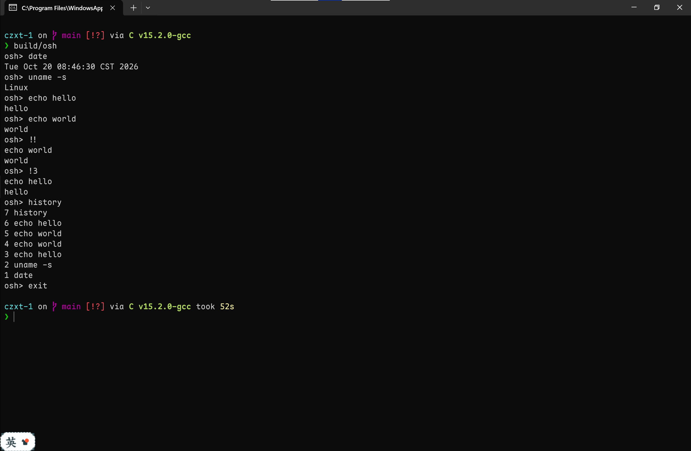
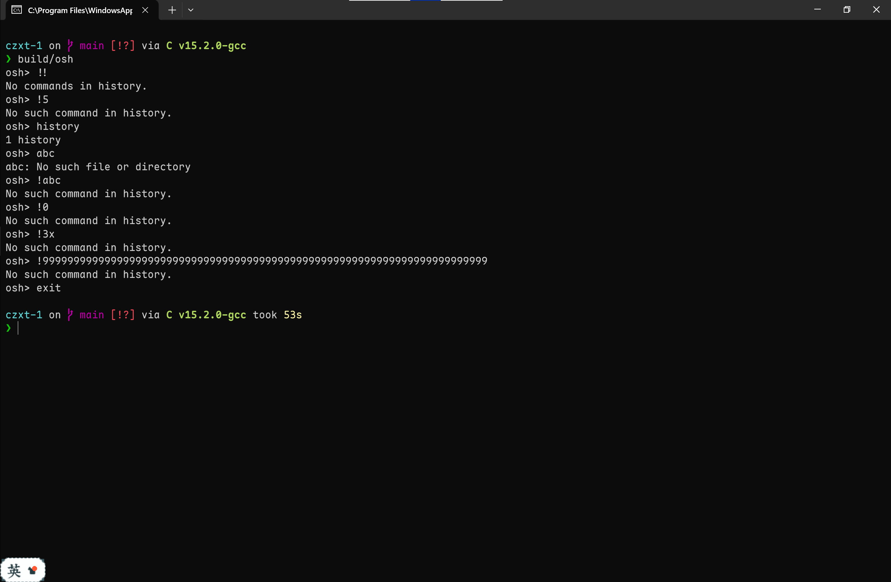
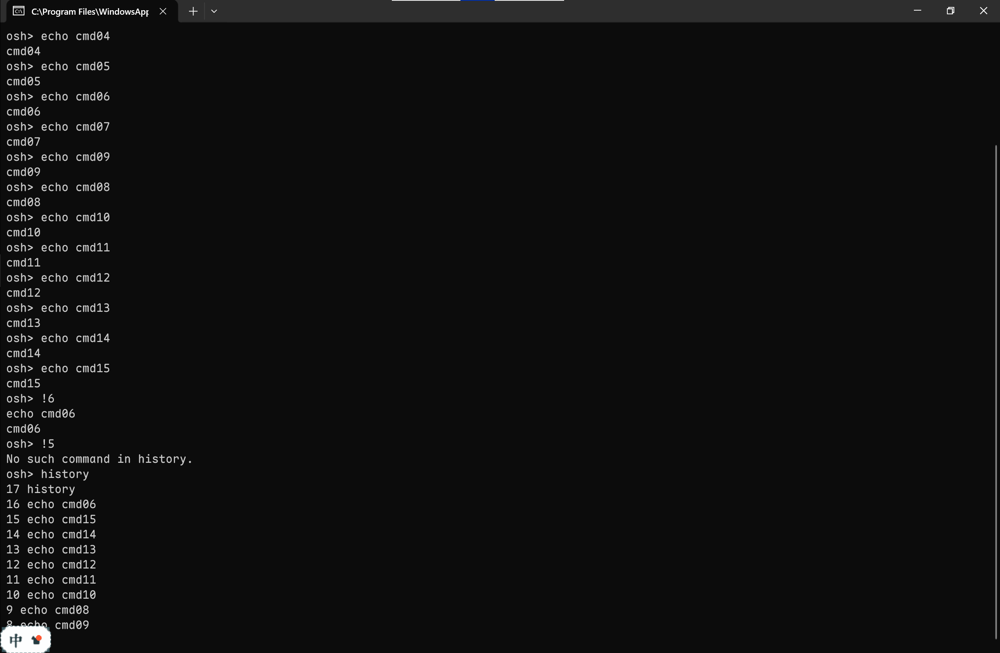
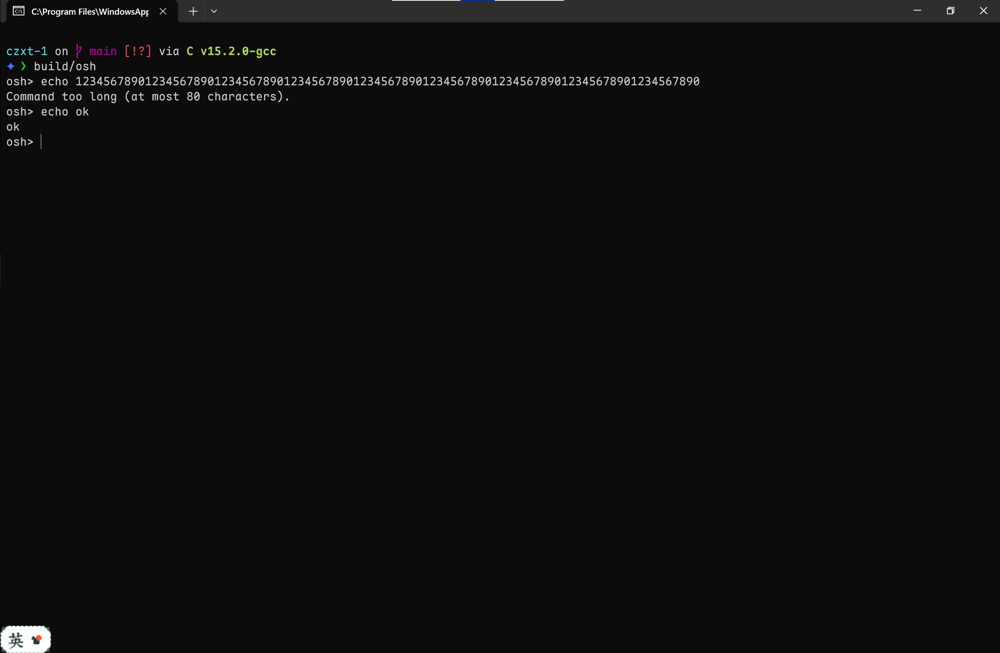
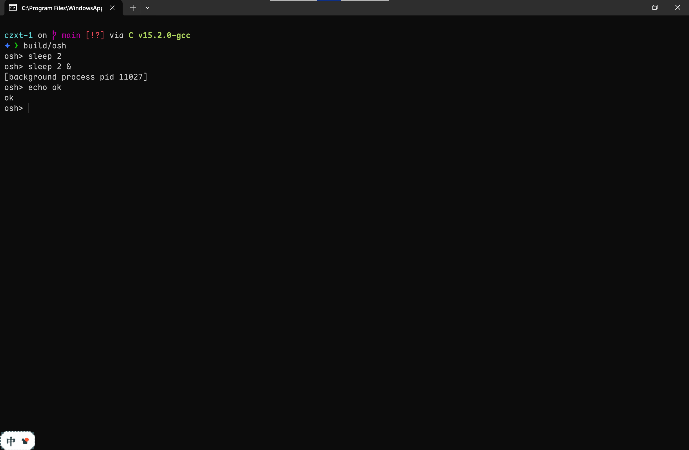
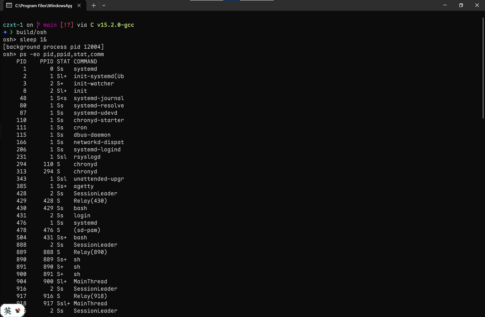
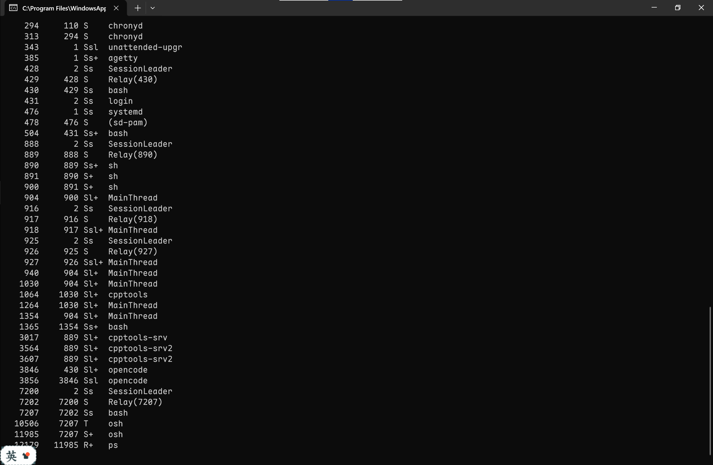

# Lab01 实验报告：带历史记录功能的 UNIX Shell

| 项目        | 内容                                        |
| ----------- | ------------------------------------------- |
| 姓名 / 学号 | 贾筱雨 / 24281099                           |
| 完成方式    | 单人完成                                    |
| 实验环境    | Ubuntu（WSL2，Linux 6.18），gcc 15.2.0，C99 |
| 源码        | `osh.c`                                     |

## 1. 实验目的

1. 理解操作系统中 Shell 的作用，以及它所依赖的系统调用。
2. 练习创建进程，并协调父进程与子进程的运行。

## 2. Linux 提供的进程控制方法

### 2.1 创建进程

| 接口      | 作用                                                    | 用法要点                                                                                                                  |
| --------- | ------------------------------------------------------- | ------------------------------------------------------------------------------------------------------------------------- |
| `fork()`  | 复制调用者，产生子进程                                  | 返回两次：父进程得到子进程 pid（大于 0），子进程得到 0，失败返回 -1。子进程拥有父进程内存的独立副本（实现上采用写时复制） |
| `vfork()` | `fork` 的变体，子进程在 `exec` 或退出前与父进程共享内存 | 子进程只能立即 `exec` 或 `_exit`，现代代码中较少使用                                                                      |
| `clone()` | 更底层的创建接口，可选择与父进程共享哪些资源            | 线程库（如 pthread）在 Linux 上基于它实现                                                                                 |

### 2.2 执行新程序：`exec` 家族

`exec` 把调用进程的代码和数据替换为新程序，进程号保持不变，成功时不会返回。

| 接口                | 参数形式                | 是否搜索 `PATH`  |
| ------------------- | ----------------------- | ---------------- |
| `execl` / `execv`   | 参数逐个列出 / 参数数组 | 否，需给完整路径 |
| `execlp` / `execvp` | 参数逐个列出 / 参数数组 | 是               |
| `execle` / `execve` | 额外指定环境变量        | 否               |

本实验使用 `execvp(args[0], args)`：参数放在以 `NULL` 结尾的数组里，并且可以直接写 `ls` 而不必写 `/bin/ls`。

### 2.3 等待与回收

| 接口                             | 作用                                                                                                             |
| -------------------------------- | ---------------------------------------------------------------------------------------------------------------- |
| `wait(&status)`                  | 阻塞，等待任意一个子进程结束                                                                                     |
| `waitpid(pid, &status, options)` | 可指定等待哪个子进程；`pid = -1` 表示任意子进程；`options` 为 `WNOHANG` 时不阻塞，没有已结束的子进程就立即返回 0 |

子进程结束后，其退出状态会保留在内核中，直到父进程调用 `wait` 系列函数读取，在此期间它是僵尸进程。

### 2.4 终止进程

| 接口       | 区别                                                                   |
| ---------- | ---------------------------------------------------------------------- |
| `exit(n)`  | C 库函数：先刷新 `stdio` 缓冲区、运行 `atexit` 注册的函数，再结束进程  |
| `_exit(n)` | 系统调用：直接结束进程，不做用户态清理。在 `fork` 之后的子进程里更稳妥 |

### 2.5 其他相关接口（本实验未使用）

- `getpid()` / `getppid()`：获取自己 / 父进程的编号。
- `kill()`、`signal()` / `sigaction()`：发送信号、处理信号（如 `SIGCHLD` 表示子进程状态变化）。
- `pipe()`、`dup2()`：创建管道、重定向文件描述符，用于实现 `|` 与 `>`。

## 3. 程序设计

### 3.1 总体流程

`main()` 在 `should_run` 为 1 时循环，每轮：

```
回收已结束的后台子进程 → 打印 osh> → 读入一行
  ├─ 读到 EOF（Ctrl+D）          → 退出循环
  ├─ 超过 80 个字符              → 提示并丢弃整行
  ├─ 空行                        → 跳过
  ├─ 以 ! 开头                   → 在历史中查找；查不到则报错并跳过
  ├─ 存入历史
  ├─ 切分为 args 数组，识别 &
  ├─ exit                        → should_run = 0
  ├─ history                     → 打印历史
  └─ 其他                        → fork；子进程 execvp；父进程 waitpid 或直接返回
```

### 3.2 Part I：创建子进程

解析（`parse`，第 30 到 51 行）：用 `strtok` 按空格、制表符、换行切分，得到 `args[0..argc-1]`，末尾置 `NULL`。最多 40 个单词（80 个字符最多放 40 个单字符的单词）。若最后一个单词以 `&` 结尾，就去掉它并把 `background` 置 1；`ls &` 与 `ls&` 两种写法都支持。

执行（第 121 到 133 行）：

```c
pid_t pid = fork();
if (pid < 0)         perror("fork");
else if (pid == 0) { execvp(args[0], args); perror(args[0]); _exit(127); }
else if (background) printf("[background process pid %d]\n", pid);
else                 waitpid(pid, NULL, 0);
```

- 子进程 `execvp` 成功后就不再是 `osh`，后面两行只在命令不存在等失败情形下才会执行。`_exit(127)` 保证失败的子进程不会继续留在循环里变成第二个 Shell，127 是 Shell 中“命令未找到”的惯用退出码。
- 前台命令：父进程 `waitpid(pid, …)` 阻塞，只等这一个子进程。
- 后台命令：父进程不等待，打印子进程 pid 后立即返回提示符。
- 每轮循环开头调用 `reap_background()`，即 `waitpid(-1, NULL, WNOHANG)` 循环，回收已结束的后台子进程，避免僵尸进程堆积。
- `exit` 与 `history` 作为内置命令由父进程直接处理，不 `fork`：它们要修改或读取 Shell 自身的状态，而子进程只拥有独立的副本。

### 3.3 Part II：历史记录

数据结构：10 个槽位的环形缓冲区 `history[10][81]`，加一个只增不减的计数器 `total`（已输入的命令数，同时也是最新一条命令的编号）。

```c
add_history: strcpy(history[total % 10], cmd); total++;
get_history(n): 当 n < 1 或 n > total 或 n <= total - 10 返回 NULL，否则返回 history[(n-1) % 10]
```

编号从 1 开始，超过 10 后继续递增；输入 35 条命令后，缓冲区中保存的是第 26 到 35 条。

`history`：从 `total` 向下遍历至多 10 条，按“编号 命令”的格式从新到旧输出。

`!!` 与 `!N`（第 81 到 103 行）：

- `!!`：历史为空则输出 `No commands in history.`，否则取第 `total` 条。
- `!N`：用 `strtol` 转换；`!` 后没有数字、数字后有多余字符、溢出、或编号不在窗口内，一律输出 `No such command in history.`。
- 找回的命令先回显，再覆盖 `input`，之后走与手动输入完全相同的流程（存入历史、解析、执行）。因此历史里保存的总是展开后的真实命令，不会出现 `!!`；出错的 `!!` / `!N` 不会写入历史。

### 3.4 编译与运行

```bash
mkdir -p build && gcc -std=c99 -O2 -Wall -fno-asm osh.c -o build/osh --static -lm && ./build/osh
```

## 4. 实验结果与分析

> 说明：以下输出是把命令通过管道送给 `osh` 得到的。此时终端不会回显输入，所以提示符 `osh>` 后直接跟着命令的输出。

### 4.1 基本命令、历史记录与 `!!` / `!N`

输入：`date`、`uname -s`、`echo hello`、`echo world`、`!!`、`!3`、`history`、`exit`



分析：带参数的命令（`uname -s`）正确执行；`!!` 与 `!3` 都先回显再执行，且被作为第 5、6 条存入历史；`history` 从新到旧输出，并把自己也记为第 7 条。

### 4.2 错误处理

输入：`!!`（历史为空）、`!5`、`history`、`abc`、`!abc`、`!0`、`!3x`、`!9999999999999999999999999999999999999999`



分析：空历史下的 `!!`、越界编号、非数字、`0`、数字后带多余字符、溢出的数字，均给出规定的提示，且都不写入历史（随后的 `history` 只有它自己这一条）。不存在的命令由 `execvp` 失败后的 `perror` 报告，子进程 `_exit(127)` 退出，`osh` 继续运行。

### 4.3 历史窗口（35 条命令之后）

先输入 15 条 `echo cmdN`，再输入 `!6` 和 `!5`：



分析：输入 15 条命令后，窗口为第 6 到 15 条；`!6` 作为第 16 条加入后窗口滑到 7 到 16，所以 `!5` 已无法找回，符合题目对编号的描述。

### 4.4 超长输入

输入一行超过 80 个字符，之后输入 `echo ok`：



分析：超长的行被整行丢弃，剩余字符不会残留到下一次读取，所以后面的 `echo ok` 正常执行。

### 4.5 前台与后台

分别输入 `sleep 2` 和 `sleep 2 &`，可观察到后者瞬间返回，同时输出 pid（无法计时，可复现）：



分析：前台命令使父进程阻塞约 2 秒；后台命令父进程几乎立即返回，与子进程并发运行，对应题目中“加 `&` 则父子并发”的要求。

### 4.6 僵尸进程的回收时机

输入 `sleep 1 &`，等待 2 秒（此时 `sleep` 已结束），再输入 `ps -eo pid,ppid,stat,comm`：



在 `ps` 之前多按一次回车，则再次查看时 `sleep` 已消失。

分析：`reap_background()` 只在显示提示符前调用，而程序在读入输入时是阻塞的，所以后台进程在等待输入期间结束后，会保持僵尸状态，直到用户再按一次回车，下一轮循环才将其回收。这是当前设计的已知局限（见 5.4）。

## 5. 遇到的问题与解决

### 5.1 解析时字符串被修改，历史需要保存完整命令

`strtok` 是原地切分，会把分隔符改成 `'\0'`，`args[i]` 只是指向原字符串的各个位置。解决：先把原始命令存入历史，再复制一份到 `line` 交给 `parse`；`line` 在命令执行期间保持有效。

### 5.2 `!!` / `!N` 展开后应存入历史

题目要求“找回的命令也要作为下一条存入历史”。解决：在展开之后、`add_history` 之前把 `input` 替换为找回的命令，因此历史里不会出现 `!!`，也避免了 `!!` 引用自身的问题。

### 5.3 命令超长时残留字符

`fgets` 最多读 81 个字符，超长的行剩下的部分会被当成下一条命令。解决：读到的内容中没有换行符，就把这一行剩余字符读完丢弃，再报错；用 `!feof(stdin)` 排除“最后一行没有换行符”的正常情形。

### 5.4 后台进程产生僵尸进程

后台子进程没人 `wait` 就会成为僵尸。解决：每轮循环开头用 `waitpid(-1, NULL, WNOHANG)` 清理。但如实验 4.6 所示，回收有延迟。彻底的做法是处理 `SIGCHLD` 信号，在子进程结束的瞬间回收，本次未实现。

### 5.5 输出重定向时回显与命令输出的顺序

`stdout` 在终端中按行缓冲，而被重定向到管道或文件时按全缓冲。此时 `!!` 回显的那行会留在缓冲区里，而子进程的输出直接写出，命令输出会出现在回显之前。解决：`fork` 前再次 `fflush(stdout)`。

### 5.6 `!N` 的数值检查

直接把 `strtol` 的 `long` 结果强转为 `int` 可能溢出后误判为合法编号。解决：先检查 `errno`，并在转换前用 `n > total` 排除过大的值，再交给 `get_history`。

### 5.7 `exec` 失败后的子进程

`execvp` 失败（如命令不存在）时，子进程仍是 `osh` 的副本。解决：打印错误后立即 `_exit(127)`，避免出现两个 Shell 争抢输入。

## 6. 局限

- 不支持引号、管道、重定向：`parse` 只按空白切分，`|` 和 `>` 会被当作普通参数。
- 不支持 `cd` 等需要修改 Shell 自身状态的命令：`cd` 若交给子进程，只会改变子进程的目录。
- 后台僵尸进程的回收有延迟（见 4.6）。

## 7. 参考资料

- AI：用于讲解 Linux 命令与系统调用，协助编写和调试代码、整理文档。
- `man` 命令。

## 8. 建议与体会

无建议。

在与 AI 协作编写这份 C 代码的过程中，我体会到了 `strtok`、字符串指针和字符串末尾 `\0` 的实际用处；理解了 Linux 把 `fork` 与 `exec` 分成两步的设计：`fork` 后通过返回的 `pid` 区分父子进程，再用条件判断让父进程 `waitpid`、子进程 `execvp`。我还初步了解了 Shell 对输入、输出及缓冲区刷新的处理，对 Linux 进程的实际运行方式有了更深的认识。